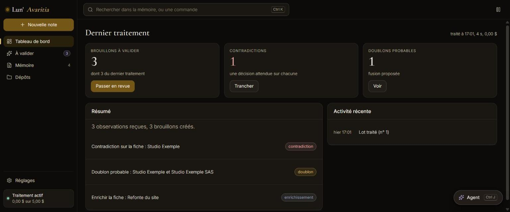

<div align="center">


# Lun'Avaritia

**Une mémoire que tu gardes : un wiki de fiches liées, où rien n'entre sans ta validation.**

Chaque fiche (personne, lieu, projet, idée...) garde ses faits, ses liens et son historique. Un agent trie ce qui arrive
et propose, toi seul décides. Un fait démenti est barré et daté, jamais effacé.

[](https://github.com/Lun-Ecosystem/lun-avaritia/releases)
[](https://github.com/Lun-Ecosystem/lun-avaritia/actions/workflows/ci.yml)
[](LICENSE)
[](https://nodejs.org)
[](https://svelte.dev)
[](https://crolix-website.vercel.app)



</div>

## Ce qu'il fait

- **Les fiches** : des faits sourcés, des liens, des versions, en arborescence ou en graphe.
- **Les brouillons** : l'agent traite le lot du jour et propose ; une contradiction ou un doublon attend ta décision.
- **Tes fichiers restent à toi** : import Obsidian, et export Markdown d'un fichier par fiche.
- **Une app installable** : une PWA servie par le serveur lui-même.

## Ce qu'il te faut

- Node `^22.13.0 || >=24`.
- Une clé de fournisseur d'IA, facultative : Anthropic, OpenAI, Gemini, Mistral ou un service compatible OpenAI, dont un
  modèle local.

## L'essayer sans clé

```bash
npm install
npm run build && npm run demo   # http://127.0.0.1:8798
```

Base en mémoire, données inventées, aucun réseau. La commande affiche un code d'appairage pour le navigateur.
`DEMO_FICHES=3000` donne une base assez grande pour le graphe. Le parcours complet est dans
[docs/prouver-avaritia.md](docs/prouver-avaritia.md).

## Démarrer en local

```bash
cp .env.example .env
npm install
npm run build        # construit le front, servi par le serveur à la racine
npm run dev          # http://127.0.0.1:8789
npm run pair-code    # dans un autre terminal, le code à saisir dans le front
```

Aucune dépendance au NAS : tout tourne sur le poste. En développement, `npm run dev -w @lun-avaritia/app` lance Vite, qui
relaie `/api` et `/lun` vers le serveur.

La base est copiée une fois par jour dans `backups/`, à côté d'elle (`data/backups/avaritia-AAAA-MM-JJ.db` par défaut) :
dès que le serveur écoute, puis chaque heure si la copie du jour manque, ce qui rattrape un poste éteint la nuit. Les
sept dernières restent ; une copie ratée laisse une ligne au journal du serveur et se retente l'heure suivante. Les clés
d'IA saisies y restent chiffrées : seule la même `AVARITIA_SECRET_KEY` les relit. Restaurer une copie :
[Mettre le desktop en service](https://github.com/Lun-Ecosystem/lun-docs/blob/main/docs/mise-en-service-desktop.md#restaurer-une-copie),
dans lun-docs.

## Si ça coince

| Ce que tu vois | Quoi faire |
|---|---|
| Une clé de fournisseur ne s'enregistre pas | Renseigner `AVARITIA_SECRET_KEY` dans `.env` : 32 octets en base64, la commande est dans `.env.example`. |
| Le serveur refuse de démarrer sur `AVARITIA_SECRET_KEY` | Elle doit faire exactement 32 octets une fois décodée. |
| La page racine ne montre pas l'app | Lancer `npm run build`, qui construit `app/dist`. |

## Dans l'écosystème

**Rôle dans l'écosystème** : satellite, le cerveau. Il possède le wiki neutre, ses brouillons, le traitement du lot
quotidien, l'import et l'export. Il fonctionne seul. Lun'Anima s'y branche par le [contrat satellite](https://github.com/Lun-Ecosystem/lun-docs/blob/main/standards/contrat-satellite.md) (v1.4), lui envoie un lot par
jour et garde pour lui la mémoire de la relation.

## Documentation

- [`docs/`](docs/) : ce que fait le projet aujourd'hui.
- Règles communes : [lun-docs](https://github.com/Lun-Ecosystem/lun-docs).

## Contribuer

Une branche, une PR avec critères de fin et preuves, CI verte. Seul CrOliX merge. Les règles viennent de
[lun-docs](https://github.com/Lun-Ecosystem/lun-docs).

## Licence

[MIT](LICENSE).
